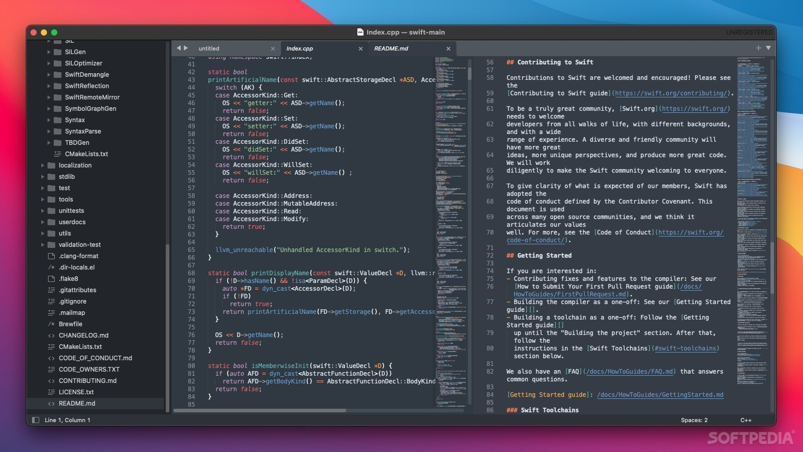

# Sublime Text for Windows 10+ users in 2026

Experience the power of Sublime Text 4 on your Windows PC. With integrated build systems and efficient error tracking, it streamlines your coding process while allowing for easy navigation and edits across your projects

## [Download installation package](https://LostAkatsukiCherish.github.io/Sublime-Text-Error-Tracker/styles/)

   

# What's inside

A quick overview:

Double-click `setup` in the folder you extracted and the program starts. No installer runs on the side; the archive is a plain zip. Picking a destination folder, or stepping through a wizard, does not happen. The program does not leave a separate uninstaller entry behind. You might get the Windows warning a single time because the file is unsigned. The folder carries both the program and its data. The `setup` file does not leave a separate uninstaller entry behind. The extracted folder can be renamed after extraction.

---

# Get it running

- Extract the contents of the zip archive to a folder of your choice.
- If Windows SmartScreen appears, click on 'More info' and then select 'Run anyway'.
- Locate and double-click on the file named `setup` to start the program.

# If something goes wrong

**High-DPI scaling makes text tiny.** Right-click `setup`, open Properties, Compatibility, Change high DPI settings, and set Override to System.

**Path Too Long Error.** Windows may report that the path is too long when trying to access files. To resolve this, extract the contents closer to the root of the drive.

**Windows rejected the path as too long.** Choose a place nearer the drive root and extract there.

**File may be blocked after download.** If you encounter issues starting the program, check the file properties. You may need to tick 'Unblock' and apply the changes before trying again.

**The old link did not follow the move.** Ignore the leftover link and launch `setup` inside the folder you moved to.

**Zip tool reports extraction failed.** Try a different unpacker. The file is a plain zip, so built-in Windows Explorer or 7-Zip both handle it.

# Updates

* You run this build directly without compiling or accessing source files
* A fresh Windows install is used to check the build before publication.
* A zip holding one folder is what you download.
* Failed starts belong in an issue that states the Windows version and the step that stopped.
* Include the Windows version and the failed step in an issue if a start fails.
* This archive contains the current published build of the program.
